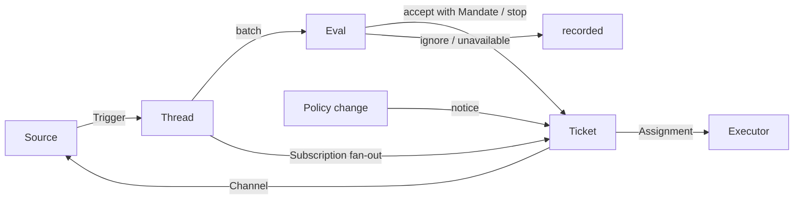

# 001 Модель предметной области

Этот документ называет концепции dsh-superagent и правила, которые каждая из них хранит. Код, инструменты, которые вызывают агенты, панель и другие документы используют эти термины и никакие другие. Следуя [000 Philosophy](000-philosophy.md), модель содержит только концепции, нужные для работы, а бизнес-потребность становится атрибутом одной из них.

## Поток

Работа движется от Триггера к Оценке и к исполнению. Источник порождает Триггеры. Триггер раздаётся как контекст Тикетам, подписанным на его Треды. Сообщение человека, дошедшее до Тикета этим путём, остаётся с этим Тикетом; каждый другой Триггер попадает в Оценку, которая решает, запрашивает ли он новую работу. Когда Оценка принимает, она создаёт Тикет с Мандатом. Назначение передаёт Тикет Исполнителю, а результаты возвращаются в Источник через Канал.

## Концепции

Источник, Тред, Оценка, Мандат и Подписка образуют ядро домена; остальное их поддерживает.

| Концепция | Определение | Правила, которые она хранит | Зачем она существует |
| --- | --- | --- | --- |
| Источник | Поток событий. Вид Источника — это переиспользуемая реализация; экземпляр Источника — одна конфигурация вида: запущен ли он и что слушает | Хранит свою позицию чтения и собственную идентичность бота. Определяет, что считается событием, включая условия, которые выполняются только со временем. Отбрасывает собственные сообщения бота и Триггеры вне того, что он слушает, прежде чем они попадут в домен. Переводит каждый Триггер в Треды, к которым он относится, и в адреса Каналов для ответа | Перезапуск не должен воспроизводить события |
| Триггер | Одно неизменяемое событие с собственными метаданными Источника, такими как его действующее лицо | Принадлежит одному или нескольким Тредам. Приём Триггера дважды создаёт один Тикет | Единица аудита и идемпотентности |
| Тред | Триггеры в порядке по времени; Источник определяет, какие Триггеры образуют один Тред | На нём одновременно выполняется не более одной Оценки. У него может быть несколько Тикетов. Он хранит свои Подписки, выполняющуюся Оценку и историю своих Решений | Даёт Оценке согласованный взгляд и её контекст |
| Корреляция | Отношение между Тредами, к которым относится один Триггер | Добавляет контекст; никогда не маршрутизирует | Позволяет Оценке следовать за связанными свидетельствами |
| Канал | Сторона записи Треда; Источник определяет его адреса | У Треда может быть несколько Каналов; Тикет хранит их набор | Подтверждения, ответы, pull request и разрешённые ревью — всё это записи |
| Политика | Версионированные правила оценки и часть каждого Источника: кто может инициировать работу через этот Источник, в собственных идентичностях этого Источника, как синхронизируется список и какие боты могут создавать кандидатов | Версия Политики охватывает правила, режим приёма и части Источников. Изменение, затрагивающее живой Тикет, например изменение правила, по которому он был принят, доставляется в его Назначение; оно не отзывает Мандаты. Идентичности на разных Источниках никогда не сопоставляются друг с другом | Когда правила меняются, выполняющаяся Оценка должна быть отброшена |
| Оценка | Суждение о пакете Триггеров, в двух слоях: шлюз и анализ | Вход: пакет Триггеров, снимок Треда, каждый Тикет на Треде, включая завершённые, и текущая Политика. Выход: Решение. Не хранит состояние | Решает, начинается ли, продолжается ли или останавливается новая работа |
| Мандат | Что даёт приём: версия Политики, область, сила, совпавшие правила, идентичность отправителя в этом Источнике и как Источник получил Триггер | Неизменяем; более широкая область означает новый Тикет. Завершение Тикета не завершает его: только остановка человеком отзывает его, а Политика, которая больше его не содержит, отменяет его. Перепроверяется против текущей Политики перед возобновлением завершённого Тикета | Указывает, почему работа может быть выполнена и как далеко она может зайти |
| Тикет | Единица санкционированной работы | Только Оценка создаёт его. Ссылается на свой Мандат; хранит свои Каналы и Входы. Идёт open → ended и обратно к open, когда сообщение человека на одном из его Тредов возобновляет его, если человек его не остановил. Определяет собственное состояние, а не следует за состоянием Исполнителя | Владеет исполнением и его отчётами |
| Назначение | Привязка Тикета к одному экземпляру Исполнителя | У Тикета их несколько со временем. Идёт pending → running → ended независимо от Тикета. Только его финальный отчёт может завершить Тикет со стороны Исполнителя | Исполнитель вне домена, но тот, кто исполняет, должен быть внутри него |
| Подписка | Отношение многие-ко-многим между Тикетами и Тредами, хранимое Тредом | Совпавший Триггер раздаётся каждому живому подписанному Тикету без проверки того, кто его отправил; сообщение человека, дошедшее до Тикета этим путём, не проходит Оценку. Тред, за которым Исполнитель следит для контекста, достигает его Тикета тем же путём, но не даёт ему полномочий и не возобновляет его. Завершённый Тикет сохраняет свои Подписки, включая pull request, который закрылся или был смерджен: сообщение человека возобновляет его под тем же Мандатом, без Оценки или Решения; сообщения от ботов и CI не достигают его, поскольку его Исполнитель заново читает его Треды при возобновлении. Тикет, который человек остановил, не получает ничего. Главная Сессия прикрепляет Тред к существующему Тикету только тогда, когда его сообщение явно указывает на этот Тикет. Человек может удалить все Подписки на Треде; Исполнитель может удалить только Подписку собственного Тикета на Тред, который считает не относящимся к делу, кроме Треда, с которого начался его Тикет, и Треда, за которым Источник заставил его следить, например его pull request | Более позднее обсуждение достигает Исполнителя, и никому не нужно снова упоминать агента |

Человек не является доменной концепцией. Триггер несёт идентификатор своего действующего лица так, как его даёт Источник. Список разрешённых — это часть Источника в Политике, в идентичностях этого Источника. То, что у одного человека есть аккаунты на нескольких Источниках, — это текст промпта, который агенты читают, когда это нужно.

Исполнитель, со своими Сессиями и директориями, находится вне домена и соединяется через Назначения.

Агрегаты: Источник хранит свою позицию чтения. Тред хранит свои Подписки, свою выполняющуюся Оценку, которая выполняется последовательно и сливает Триггеры, приходящие тем временем, в следующий пакет, и свою историю Решений. Тикет хранит свои Назначения, Каналы и Входы и ссылается на Решения по id.

## Отклонённые концепции

| Отклонено | Причина |
| --- | --- |
| Principal или Membership как сущность, или сопоставление идентичностей между Источниками | Человек — это метаданные Триггера; список разрешённых — часть Источника в Политике; меж-Источниковое сопоставление — текст промпта |
| Оценка, планирующая свои собственные отложенные Триггеры | Условие, требующее ожидания, — это обычный Источник, поэтому Оценка никогда не зависит обратно от Источников |
| Состояния Оценки waiting или revoked | Waiting принадлежит Источникам; Оценка, у которой вышло время, снова ставит свои Триггеры в очередь или завершается `unavailable` |
| Не более одного живого Тикета на Тред | Один Тред может нести несколько независимых частей работы; анализ избегает дубликатов по списку Тикетов |
| Решение «append to Ticket» | Добавление — это раздача Подписки и не требует Оценки |
| Проверки Admission на Подписках | Подписка охватывает весь Тред; Мандат отделяет авторизацию от контекста |
| Корреляция, которая маршрутизирует | Подписки маршрутизируют; Корреляция только добавляет контекст |
| Состояние Тикета, следующее за DSH Session | Тикет может быть передан, возобновлён или выполнен несколькими Исполнителями, поэтому он определяет собственное состояние |
| Исполнитель, заявляющий, что человек попросил его остановиться | Только Оценка решает силу завершения |
| Отмена выполняющихся Тикетов при изменении Политики | Отменённое изменение оставляет наполовину готовую работу; изменение фиксируется и доставляется вместо этого |
| Блокировка всех инструментов Сессии Исполнителя при сбое или блокировке | Это отказало бы человеку, работающему в Сессии напрямую, и отчёту после восстановления; достаточно приостановить автоматический вход |
| Вывод «ждёт человека» из свободного текста отчёта | Классификация требует структурированных фактов; Исполнитель спрашивает через структурированное поле |

## Что переиспользуемо

Концепции выше и их правила переиспользуемы. Реализации Источников, содержимое Политики, Исполнитель и реализации Каналов принадлежат развёртыванию. Каждый Источник хранит собственные слова внутри, такие как message, chat или notification, и переводит их в Триггеры.

| Часть | В этом репозитории |
| --- | --- |
| Источник | Feishu: живые события, восстановление истории, опрос подписанных тем. GitHub: уведомления, подписанные Issue и pull request, изменения CI, pull request смердженные или закрытые, и, где включено, каждый новый Issue, pull request и комментарий в репозитории и CI базовой ветки |
| Политика | Правила оценки и список разрешённых каждого Источника, его синхронизация, его список ботов и его таблица приёма |
| Исполнитель | DSH Executor Session и директория на Тикет, в среде исполнения, чьи переменные регистрируют Исполнитель и Источники |
| Канал | Ответы в темы Feishu, комментарии GitHub и ответы в ветки ревью |

## Глоссарий

Справочный список терминов, которые используют этот и последующие документы, с их китайскими названиями; последующие документы объясняют термины, не введённые выше. Панель показывает один язык за раз; её кнопка (?) открывает этот глоссарий с обоими языками. Сообщения, которые агенты отправляют людям на GitHub и в Feishu, используют повседневный язык, а не эти термины.

| Term | 中文 | Meaning |
| --- | --- | --- |
| Agent | 智能体 | Автоматизированный член команды, которым управляет dsh-superagent, действующий на Источниках через идентичности, такие как аккаунт GitHub и бот Feishu |
| Main Session | 主 Session | DSH Session, которая оценивает Триггеры, принимает и отправляет Тикеты и отвечает; `orchestrator` в коде и промптах |
| Executor Session | 执行器 Session | DSH Session, которую Исполнитель запускает для одного Тикета; `worker` в коде и промптах |
| Source | 来源 | Поток событий: вид, который предоставляет плагин, плюс одна конфигурация экземпляра |
| Trigger | 触发 | Одно неизменяемое событие от Источника |
| Thread | 线程 | Триггеры в порядке по времени; единица, внутри которой Оценки выполняются по одной за раз |
| Correlation | 关联 | Отношение между Тредами, которые разделяют Триггер; только добавляет контекст |
| Channel | 渠道 | Сторона записи Треда |
| Policy | 策略 | Версионированные правила приёма работы и часть каждого Источника, например кто может запрашивать работу там |
| Policy version | 策略版本 | Идентификатор одной комбинации правил, частей Источников и режима приёма; каждый Мандат фиксирует его |
| Eval | 评估 | Процесс, который превращает пакет Триггеров в Решение |
| Gate | 准入 | Детерминированный первый слой Оценки: кто может инициировать работу и с какой силой |
| Assessment | 研判 | Суждение модели во время Оценки |
| Decision | 决定 | Результат Оценки |
| Mandate | 授权 | Что даёт приём: сила, область и версия Политики, на которую он опирался |
| Ticket | 工单 | Единица санкционированной работы |
| Assignment | 派工 | Привязка Тикета к одному экземпляру Исполнителя |
| Subscription | 订阅 | Отношение между Тикетом и Тредом |
| Fan-out | 扇出 | Доставка Триггеров подписанного Треда в Тикет как контекста |
| Executor | 执行器 | Порт, который выполняет Назначения: одна Executor Session и одна директория на Тикет |
| Execution environment | 执行环境 | Где выполняются Executor Sessions и команда prepare: переменные, которые регистрируют Исполнитель и Источники, каждая с ключом, значением и описанием |
| Report | 报告 | Состояние, которое Назначение сообщает своему Тикету |
| Attention | 待人工决定 | Вопрос к Тикету, который ждёт ответа человека |
| Disposition | 去向 | Запись о том, как Триггер был отфильтрован, оценён или раздан |
| Input | 输入 | Контекст, доставленный Тикету: розданные Триггеры, изменения Политики, возобновления и текст |
| Scope | 范围 | Работа, которую позволяет Мандат |
| Strength | 强度 | Насколько сильна основа Мандата или Оценки |

| Group | Values |
| --- | --- |
| Decision | accept 接单 · stop 停止 · ignore 忽略 · unavailable 未完成 |
| Strength | explicit 明确 · inferred 推断 |
| Assignment | pending 待启动 · running 执行中 · ended 已结束 |
| Report | progress 进展 · waiting 等待 · ready 就绪 · blocked 受阻 · failed 失败 · dropped 无需处理 |