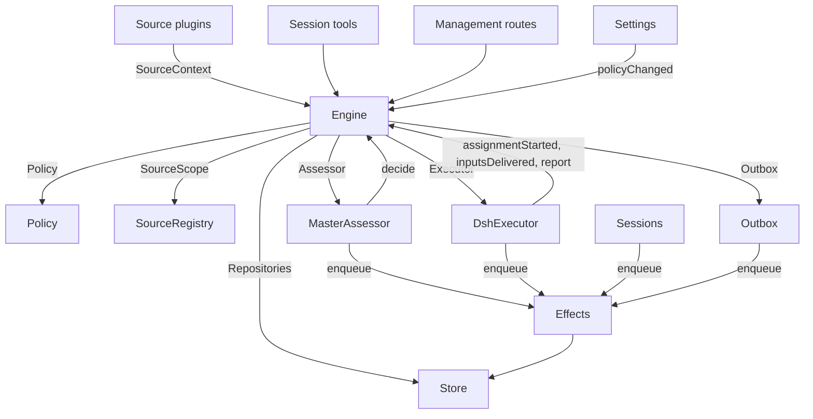

# 007 Архитектура

Это руководство разработчика по реализации. Оно сопоставляет понятия из [001 Domain model](001-domain.md) по [006 Deployment](006-deployment.md) с классами, интерфейсами и файлами. Начните с рантайма и Engine, затем используйте таблицы модулей и тестов как указатель по коду.

## Основные классы и связующий код

Основные классы владеют доменными понятиями и внешними границами за небольшими интерфейсами. Связующий код переводит аргументы инструментов, HTTP-запросы, полезные данные Источников и события DeepSeek Harness в вызовы этих классов, а затем превращает результаты в карточки, представления и сообщения.

`Runtime` (`src/app/runtime.ts`) конструирует приложение, поставляет зависимости и владеет запуском и остановкой. `Engine` конструирует свои собственные внутренние части. Исполнитель и Оценивающий вызывают Engine по обратному вызову, поэтому Runtime даёт им геттеры, а не требует конструирования в циклическом порядке.

### Runtime

`Runtime` — это корень композиции; он не содержит доменных правил. Его конструктор блокирует каталог состояния, открывает Store и строит каждый компонент. Если конструирование не удаётся, он закрывает Store и снимает блокировку.

Запуск регистрирует маршруты управления и запускает Настройку. После того как настройка разрешилась, он устанавливает хуки Сессий и Исполнителей, убеждается в существовании основной Сессии, запускает синхронизации Политики, возобновляет прерванные Назначения и запускает проходы и эффекты. `ready` отмечает завершение запуска.

Остановка отменяет ходы, ждёт проходы, эффекты и агентов, восстанавливает окружение процесса, закрывает Store и снимает блокировку. Плагины Источников внедряют Runtime как сервис `orchestrator` через узкий интерфейс `SourceHost`.

| Часть | Модуль | Делает |
| --- | --- | --- |
| Setup | `src/app/setup.ts` | Разрешает репозиторий и аккаунты, проверяя их CLI так, как их запускают оболочки воркеров, записывает и применяет окружение и командные шимы воркеров и хранит проблемы настройки; Settings проверяет изменённый аккаунт через него и перезапускается через него, что снова запускает настройку |
| Passes | `src/app/passes.ts` | Один проход за раз, каждые две секунды и всякий раз, когда просит команда: сначала просроченные эффекты, затем `Engine.evaluateDue`; Триггер Источника достигает Engine через него |
| Outbox | `src/app/outbox.ts` | Порт `Outbox` Engine и единственный писатель квитанций: `send` хранит квитанцию сообщения и ставит в очередь его эффект `reply` в одной транзакции, а обработчик эффекта отправляет его через `SourceRegistry.send`; сообщение ждёт, пока его Источник выключен, и отбрасывается, когда беседа исчезла или не прослушивается |
| Notices | `src/app/notices.ts` | Превращает доменные события и активность воркера в сообщения основной Сессии. `eventNotice` обрабатывает доменные уведомления; `reportRelay` немедленно пересылает вопросы, держит обычный прогресс на его Тикете и пересылает остальные отчёты; `followupRelay` называет Тикеты, владеющие человеческим фоллоу-апом. Пересылки, прибывающие во время хода, доставляются вместе на его следующем шаге через входящие DeepSeek Harness |

### Engine

`Engine` (`src/core/engine.ts`) — единственный писатель Триггеров, Тредов, Решений, Тикетов и Назначений. Он получает эти порты из `src/core/ports.ts`: `Repositories`, геттер текущей Политики, `SourceScope`, `Assessor`, `Executor` и `Outbox`. Опциональные зависимости — `prepareTicket`, `now` и `emit`.

Все методы Engine синхронны. Каждая команда меняет свои агрегаты в одной транзакции. `evaluateDue` использует отдельную транзакцию для каждой Оценки или Тикета, которые он меняет. Порты ставят в очередь внешнюю работу внутри транзакции; адаптеры выполняют её после фиксации. Недопустимые запросы бросают `UserError`.

Engine предоставляет одну точку входа и делегирует пяти внутренним частям. Он владеет транзакцией каждой команды. Команды, охватывающие части, такие как `attach`, `evaluateDue` и `policyChanged`, вызывают части последовательно.

Каждая часть расширяет `EnginePart` (`src/core/part.ts`), который предоставляет опции и общие чтения. Зависимости между частями текут в одном направлении:

| Часть | Ответственность | Зависит от |
| --- | --- | --- |
| `Intake` | Триггер Источника: сохраняется один раз со своим положением, записывается на свои Треды и их корреляции, раздаётся подписанным Тикетам и, если это не сообщение человека, достигшее одного из них, ставится в очередь на Оценку на своём основном Треде | Tickets |
| `Evals` | Оценки Тредов: пакетирование, сила шлюза, действующее лицо и основание с давшим их Триггером (`primary`), дедлайн из доставки кандидата и его сдвиг при паузе, повторная постановка просроченной Оценки в очередь, кандидаты, повторы и возвраты, повторная постановка при изменении Политики и Решение, которым каждая заканчивается: принять, остановить, игнорировать или недоступно | Tickets |
| `Tickets` | Жизненный цикл Тикета: создание из принятия с его Мандатом, Подписками и первым Назначением, Треды, за которыми он следует, и их закрытия (`followsDone`), присоединённые Треды и Треды, отслеживаемые для контекста, Входы и заметки, возобновление и сообщения, которые возобновление отклоняет, повтор, перезапуск, остановка и завершение, Подписки, которые он отбрасывает, и уведомление о изменении Политики Тикетам, которые оно затрагивает | Replies |
| `Assignments` | Что сообщают Исполнитель и его воркеры: Назначение запущено, Входы достигли его или не достигли, перезапуск прервал его и Отчёт воркера с его вопросом к человеку | Tickets, Replies |
| `Replies` | Записи в Канал через `Outbox`: подтверждение, ответ, результат и сообщение о внимании, каждое по правилу, которое его допускает | Nothing |

Команды используют императивные имена, например `stopTicket`; факты, сообщаемые адаптерами, используют имена в прошедшем времени, например `assignmentStarted`. Запрос `candidate` использует существительное.

Вызывающие получают только `Pick` Engine для своей роли: `EngineForSources`, `EngineForMainSession`, `EngineForPeople`, `EngineForSettings` или `EngineForExecutor`.

| Роль | Метод | Эффект |
| --- | --- | --- |
| Sources | `receive(trigger)` | Сохраняет Триггер один раз и отвечает `stored`, `duplicate` или `filtered`, когда его не принимает ни один Источник; раздаёт его Тикетам, подписанным на его Треды, где сообщение человека немедленно возобновляет завершённый Тикет, если обработка не приостановлена, и ставит его в очередь на Оценку на его основном Треде, если это не сообщение человека, достигшее Тикета, — то остаётся за этим Тикетом |
| Sources | `bindThread(ticketId, thread, own)` | Заставляет открытый Тикет следовать за одним из Тредов Источника, например за pull request'ом, `own`, когда Тикет его открыл; закрытый Тред, привязанный снова, снова открыт. Закрытия Тредов, а не `ready`-Отчёт, завершают Тикет |
| Sources | `threadClosed(thread, outcome, at)` | Тред закрыт: каждый открытый Тикет, следующий за ним, записывает закрытие и завершается, когда закончил с Тредами, за которыми следует (`followsDone`): ни один открытый им Тред не открыт, или, когда он не открыл ни одного, каждый Тред, за которым он следует, закрыт. Он завершается `merged` или `closed`, как завершилось последнее из этих закрытий, кроме случаев, когда возобновлённая после закрытия работа не сообщила `ready`, или его Исполнитель взял на себя — подтвердив или ответив на него — фоллоу-ап человека, который он решает после своего последнего Отчёта, отличного от `progress`, или конца его последнего хода; тогда Отчёт `dropped` завершает его так же, как закрытие |
| Main Session | `candidate(triggerId)` | Оценка, удерживающая Триггер, как её видит её оценщик |
| Main Session | `candidateDelivered(evalId)` | Кандидат Оценки достиг основной Сессии: её дедлайн отсчитывается от сейчас |
| Main Session | `decide(triggerId, outcome)` | Записывает Решение Оценки или прямое Решение для явного запроса. Принятие создаёт Тикет, Мандат, Назначение, Подписки и подтверждение атомарно. Предполагаемый кандидат, игнорируемый из своей карточки, записывает `ignoredFromCard` перед указанной причиной. Пока `followupOwners` всё ещё владеет человеческим фоллоу-апом, допускается только остановка |
| Main Session | `attach(ticketId, triggerId, note?)` | Направляет Триггер на Тикет, на который он указывает, чей Исполнитель затем решает его как фоллоу-ап, и завершает Оценку, удерживающую его, чьи другие Триггеры ждут свежую Оценку; завершённый Тикет немедленно возобновляется под своим Мандатом, если обработка не приостановлена. Фоллоу-ап, который всё ещё решает Исполнитель, отклоняется, как и направленный обратно на Тикет, который его вернул |
| Main Session | `requestStatus(ticketId)` | Просит ожидающую Сессию Исполнителя о её статусе и отвечает, спросила ли она |
| Main Session | `note(ticketId, text)` | Даёт Исполнителю Тикета факт из другой работы как текстовый Вход, который ничего не предоставляет |
| Main Session, Executor | `reply(request)` | Ставит в очередь сообщение для Канала, который называет его цель: `acknowledgement`, `answer`, `result` или `attention` |
| People | `stopTicket(ticketId, reason?)` | Остановка человеком, которая отзывает Мандат |
| People | `retryTicket(ticketId)` | Завершает застопорившееся Назначение Тикета, который ждёт человека после Отчёта `failed` или `blocked` или чья доставка Входа не удалась (`canRetry`), и запускает новое |
| People | `reevaluate(triggerId)` | Ставит сохранённый Триггер в очередь на свежую Оценку |
| People | `unsubscribe(thread)` | Отбрасывает каждую Подписку на Треде, и Тикеты, следовавшие за ним, больше не следуют; каждый продолжает решать фоллоу-апы, полученные там |
| People | `dismiss(decisionId)` | Отклоняет проблему, которую показывает Решение `unavailable`, что Решение записывает |
| Executor | `assignmentStarted(ticketId, assignmentId)` | Назначение выполняется; его ожидающие Входы уходят |
| Executor | `inputsDelivered(ticketId, assignmentId, inputIds)` | Входы достигли Сессии Исполнителя Назначения, где каждый ждёт шага, который его заберёт |
| Executor | `inputsRead(ticketId, inputIds)` | Сессия Исполнителя забрала сообщения, несущие эти Входы, в свою историю (событие Сессии `user/message`), откуда их имеет её модель; шаг, который заявил их и был отменён или не удался до этого, не считается. Каждый считается прочитанным один раз, когда следует Отчёт или конец хода, также после перезапуска, и завершение его Тикета не отпускает его; Вход, доставленный до записи чтений, считается прочитанным, когда Отчёт или конец хода последовал за его доставкой |
| Executor | `turnEnded(ticketId, assignmentId)` | Ход Сессии Исполнителя завершился, также после Отчёта, когда для него ничего не работает в фоне или когда он передаёт работу человеку. Что шаг взял раньше, то он прочитал (`inputsRead`) |
| Executor | `deliveryFailed(ticketId, assignmentId, error)` | Доставка Входов не удалась; Тикет показывает это, пока доставка не удастся, не начнётся новое Назначение или Тикет не завершится |
| Executor | `report(ticketId, report)` | Записывает Отчёт и его вопрос к человеку; `dropped` завершает Тикет, а `ready` завершает тот, кто не следует ни за одним Тредом, и завершает тот, кто закончил с Тредами, за которыми следует, так, как они завершились |
| Executor | `markUnrelated(ticketId, thread, reason)` | Отбрасывает только Подписку этого Тикета на присоединённый Тред, который он счёл нерелевантным, и возвращает, с причиной, фоллоу-апы там, которые решает этот Тикет |
| Executor | `followForContext(ticketId, thread)` | Подписывает открытый Тикет на связанный Тред для контекста: его сообщения достигают Тикета, но не дают ему силы фоллоу-апа и не возобновляют его |
| Executor | `handback(ticketId, triggerId, reason)` | Записывает, что Тикет возвращает Триггер, который достиг его, с причиной, которую несёт его кандидат, и ставит его в очередь на свежую Оценку, когда ни один другой Тикет его не решает, если этот решал; он отвечает, поставил ли в очередь. Тикет возвращает каждый Триггер один раз и сохраняет свою Подписку |
| Executor | `assignmentInterrupted(ticketId, assignmentId)` | Назначение выполнялось, когда хост остановился: прерванное в середине работы, или получившее Вход после своего последнего Отчёта, запускается снова с заметкой о восстановлении и Входами, доставленными ему, которые его Сессия Исполнителя не забрала, как делает повтор; то, что отчиталось с тех пор, сохраняет свою Сессию. DshExecutor сообщает о каждом при запуске (`resume`), начиная с самого старого Тикета, и снова ставит в очередь запуск, который ждёт |
| Passes | `evaluateDue()` | Если обработка не приостановлена: запускает Оценки Тредов, чьи поставленные в очередь Триггеры ждут, по одной на Тред, с поставленными тем временем Триггерами как одним пакетом; снова ставит в очередь Триггеры Оценки, просрочившей дедлайн, дважды подряд, и на третий раз записывает её `unavailable`; и возобновляет завершённые Тикеты, которых сообщение человека достигло во время паузы, если их Мандаты всё ещё действуют. Оценка, чей кандидат не достиг основной Сессии, не просрочивается. Пока обработка приостановлена, ни одна Оценка не просрочивается, а как только она возобновляется, каждый дедлайн сдвигается позже на длину паузы |
| Settings | `policyChanged(from, to, effects)` | Сообщает каждому живому Тикету, которого затрагивает изменение, каким образом (`policyEffects` в `src/policy.ts`: правило, под которым он был принят, изменилось или больше не применяется, его запрашивающий больше не может начинать работу, или проактивная работа больше не принимается), и перезапускает Оценки в процессе под новой версией |

Engine держит правила пакетирования, авторизации, раздачи, возобновления и жизненного цикла внимания приватными. Несколько общих предикатов делают эти правила согласованными:

- `waitsForPerson` (`src/core/model.ts`): последнее Назначение сообщило `blocked` или `failed`, и с тех пор не приходило человеческое сообщение. Автоматические Входы и неудавшиеся запуски остаются удерживаемыми, пока это верно.
- `followupOwners`: Тикеты, всё ещё ответственные за человеческий фоллоу-ап, полученный на их собственных Тредах. Тикет может быть жив или завершён без человеческой остановки и ожидать возобновления. Возврат сообщения завершает эту ответственность.
- `settled`: Решение разрешило запрос; Решения stop, unavailable, routed и refused-stop не считаются.
- `ticketStage` (`src/core/stage.ts`): реализует таблицу стадий из [003 Execution](003-execution.md).

Когда Тикет завершается, непрочитанные фоллоу-апы возвращаются на Оценку, если другой Тикет всё ещё не владеет ими или другое положение не разрешило их. Подтверждённые, отвеченные и возвращённые сообщения исключаются. Для старых записей без положений подтверждения факт даёт квитанция аутбокса. Финальный Отчёт также покрывает сообщения, ожидавшие на момент начала Назначения, включая сообщение, которое его возобновило. Сообщение, остановившее Тикет, не переоценивается автоматически.

После изменения Engine порождает событие из `DomainEvents` в `src/core/ports.ts`:

`trigger.received`, `eval.started`, `decision.recorded`, `ticket.created`, `ticket.resumed`, `ticket.ended`, `assignment.started`, `assignment.ended`, `thread.subscribed`, `thread.unsubscribed`, `trigger.requeued` или `policy.changed`.

Runtime превращает `ticket.ended`, `trigger.requeued` и `thread.unsubscribed` в уведомления. Человеческий `trigger.received`, доставленный Тикетам, становится пересылкой фоллоу-апа. `pullEndNotices` отправляет одно уведомление в чат, используя стабильный id, когда Тикет завершается merged или closed. У других событий в настоящее время нет потребителя.

### Model

`src/core/model.ts` хранит доменные типы, а `src/core/stage.ts` — стадии Тикета. Решение записывает причину как `reason`, список `Reason` (`src/core/reasons.ts`): каждый со `code` и его `values` и, для одного Триггера пакета, его `triggerId`.

Коды ядра, такие как `timeout`, `policyChanged`, `routed` и `startedTicket`, — это `REASONS`, с английским текстом, который агенты читают через `reasonText`; шлюз или область Источника даёт свои собственные, например `not_a_member`; а `said` несёт слова, которые написал оценщик или человек. Панель формулирует каждый код через `reason.<code>`, а Триггер, отфильтрованный Источником, записывает код Источника тем же способом.

Тикет хранит каждый факт один раз. Он открыт, пока у него нет `ended`, который записывает, когда, кем, почему и с каким исходом он завершился; то, что он сказал последним, — это его последний Отчёт Назначения (`latestReport`); а его Сессия Исполнителя названа по нему (`workerSessionId` в `src/executor/dsh.ts`).

Его поля типизированы: `origin`, допустимый Триггер, давший пакету его Оценки силу, и сам пакет (`triggerId`, `triggerIds`); `execution`, что выбрал Исполнитель (`name`, `directory` и `assignment`); `delivery`, последняя неудавшаяся доставка Входа (`error`, `at`), пока доставка не удастся, не начнётся новое Назначение или Тикет не завершится; и `follows`, Треды, за которыми Источник заставил его следовать, каждый `{thread, own, closed?}`: `own`, когда Тикет его открыл, и `closed` с `at` и `outcome`, как только он закрылся. Только Tickets пишет `follows`; Источник GitHub читает свои pull request'ы через `pullsOf` и `pullOf` (`src/sources/github-pull.ts`).

Вход, несущий Триггер, записывает, написал ли его человек, что читает `waitsForPerson`. Тред также перечисляет в `context` подписанные Тикеты, следующие за ним только для контекста, и считает в `expired` Оценки своих поставленных в очередь Триггеров, просрочившиеся подряд; Оценка записывает свой `primary` Триггер и время, когда её кандидат был `delivered`.

Положение Триггера записывает Тикеты, которых он достиг, по раздаче или присоединению, повторную постановку человеком, каждый Тикет, который его вернул, с причиной, и каждый Тикет, чей Исполнитель подтвердил или ответил на него.

`basis` Мандата (`MandateBasis`) записывает, как шлюз допустил его Триггер. Перепроверка читает принимающий `source`, `scope` и `row`, перечисленного `sender`, совпавшие `rules` и `via`:

| `via` | Основание приёма |
| --- | --- |
| `addressed` | Разрешённый отправитель обратился к агенту |
| `followup` | Сообщение пришло на Тред с Тикетами |
| `admission` | Ячейка таблицы приёма; `observation` отмечает предполагаемого кандидата |
| `bot` | Перечисленный бот произвёл предполагаемого кандидата |

`meta` Триггера и Треда принадлежат Источнику. Ядро их не интерпретирует.

### Policy

`src/policy.ts` определяет схемы настроек, правила авторизации и оценки. `settingsPolicy(settings, scope)` возвращает свежую, без состояния, `Policy` при каждом использовании:

- `version`, `paused` и `evalTimeoutMs` описывают её текущее состояние.
- `gate(trigger, thread, tickets)` возвращает силу и основание приёма.
- `revalidate(mandate)` проверяет, всё ли ещё действует существующий Мандат.
- `admitsInferred(rules)` разрешает проактивное принятие только в автоматическом режиме с включёнными правилами сопоставления.

`assessmentOutcome(assessment, settings, strength)` превращает оценку модели в исход Engine. Она требует суждения по каждому включённому правилу, установившегося направления, совпавшего правила и свидетельства намерения. Вне автоматического режима предполагаемое принятие становится записью «would accept».

`policyEffects(tickets, old, now, scope)` определяет, какие открытые Тикеты затрагивает изменение и каким образом. `Engine.policyChanged` уведомляет только эти Тикеты. `policyVersion` хеширует правила, режим принятия и части Политики Источников, включая списки ботов.

### Store

`Store` (`src/app/store.ts`) владеет одной базой данных SQLite. Runtime захватывает блокировку каталога перед её открытием, не давая второму процессу мигрировать или писать то же состояние.

Его интерфейсы сгруппированы по назначению:

- **Доменные репозитории:** `atomic`, плюс `triggers`, `threads`, `tickets` и `decisions`, каждый с `get`, `save` и списко-запросами. Индексированные рабочие наборы — `threads.active()`, `tickets.open()`, `tickets.active()` и `read.subscribedThreads`.
- **Запросы чтения:** `read` обслуживает представления, инструменты и опросы Источников через методы, такие как `threadTriggers`, `triggerStats`, `search` и `droppedReplies`. Эти методы никогда не пишут.
- **Метаданные Источника:** `threads.describe` и `threads.patchMeta` обновляют принадлежащие Источнику метаданные Треда.
- **Настройки:** `settings`, `saveSettings`, `blockRevision` и `settingsHistory`. Настройки и промпты используют нумерованные `Versions` (`src/app/versions.ts`).
- **Квитанции аутбокса:** `replyStatus` и `receipts`, пишутся только Outbox. Операции квитанций — `get`, `waiting`, `behind`, `add`, `settle` и `withdraw`. `behind` проверяет, ждёт ли более раннее сообщение для того же Тикета и беседы с менее чем тремя неудачами. Отозванное сообщение завершается с `channelGone` или `channelIgnored`. Запросы чтения показывают неудавшиеся и отброшенные ответы через `failingReplies`, `droppedReplies` и `droppedSince`.
- **Типизированные записи ключ-значение:** `get`, `set`, `delete` и `keys`, используя записи из `KV`.

`afterCommit` выполняет действие только после фиксации транзакции, никогда после отката. Runtime читает записи в их сохранённой форме; миграция схемы 11 преобразует старые поддерживаемые записи при запуске.

### Effects

`Effects` (`src/app/effects.ts`) — это долговечная очередь побочных эффектов. Команда вызывает `enqueue(kind, key, payload)` внутри своей транзакции; выполнение начинается только после фиксации.

Каждая пара kind/key имеет одну строку. Постановка в очередь того же ожидающего ключа заменяет его полезную нагрузку и делает его просроченным немедленно, не меняя порядок очереди. `handle(kind, run, options)` регистрирует один обработчик на kind. Он обрабатывает просроченные строки, начиная со старейших, до предела параллелизма.

Неудачи повторяются с экспоненциальной отсрочкой. Бросок `Later` откладывает работу, не считая неудачу, например когда нет свободного слота воркера. `start` начинает обработку после настройки, `drain` останавливает её при завершении работы, сохраняя ожидающие строки, а `pending`/`idle` показывают состояние очереди.

| Kind | Обработчик | Делает | За раз | Повтор |
| --- | --- | --- | --- | --- |
| `assessment` | MasterAssessor | Направляет карточку кандидата Оценки в ход основной Сессии, затем сообщает Engine, что он доставлен, что запускает дедлайн Оценки | 4, ни одного при паузе | 2 с, удваиваясь до 60 с |
| `launch` | DshExecutor | Запускает ожидающее Назначение: команда подготовки, Сессия Исполнителя, сообщение назначения | Свободные слоты воркеров, ни одного при паузе | Преходящая неудача провайдера модели или сети повторяется через 5 с, удваиваясь до 300 с, три раза; любая другая неудача, и неудавшаяся команда подготовки, приводит к неудаче Тикета. Удерживаемое паузой или полными слотами воркеров повторяется через 5 с |
| `delivery` | DshExecutor | Передаёт ожидающие Входы Тикета его выполняющемуся Назначению, по порядку | 4, ни одного при паузе | 2 с, удваиваясь до 60 с; тот, кто ждёт слот воркера, повторяется через 2 с |
| `relay` | Sessions | Направляет отчёт или вопрос воркера, или фоллоу-ап человека, в ход основной Сессии | 1, в порядке очереди | 2 с, удваиваясь до 60 с |
| `notice` | Sessions | Внедряет уведомление в основную Сессию, не пробуждая её | 1, в порядке очереди | 2 с, удваиваясь до 60 с |
| `reply` | Outbox | Отправляет сообщение для Канала через его Источник, после более ранних сообщений его Тикета в его беседу, которые не провалились три раза; отзыв сообщения отменяет его | 1, ни одного при паузе | 5 с, удваиваясь до 300 с; тот, чей Источник выключен, или позади более раннего сообщения, повторяется через 5 с |

Каждый kind имеет запись здоровья под своим именем. Он сообщает об ошибке, когда один из его эффектов провалился три раза подряд, кроме `delivery`, чьи неудачи показываются на их Тикете. Пересылки сохраняют свой порядок, и уведомления тоже; неудавшаяся удерживает более поздние своего kind.

### Sources

Источники расширяют хост через `SourceKind`, определённый в `src/sources/kind.ts`. Кind объявляет свою идентичность, заголовок, описание, `schema` и `fields` конфигурации, производные `facts` и записи `health`. Опциональное поведение включает `scope`, `channel` (`allowed`, `send`, `link`), `threadContext`, `find`, `policy`, `environment` и `refreshLabels`.

`SourceRegistry` (`registry.ts`) владеет зарегистрированными видами и сохранёнными экземплярами и реализует `SourceScope` Engine. Регистрация заявляет записи здоровья на `HealthBoard`; дублирующиеся заявки и зарезервированные имена `sync:` отклоняются. SourceContext пишет только через заявленные записи своей регистрации, поэтому отчёты после отмены регистрации ничего не делают.

Методы конфигурации реестра включают `kind`, `instances`, `instance`, `validate`, `validatePolicy`, `policyPart`, `channelAllowed`, `declarations`, `environments`, `find` и `scope`. `find` спрашивает каждый вид, поддерживающий поиск.

Общий код получает доступ к поведению Источника через реестр. `send(message, commands)` вызывает Канал вида и возвращает `sent`, `gone` или `waiting`, если вид не установлен. `link` разрешает ссылку его Канала. `threadContext` сопрягает читателя вида с его конфигурацией или ничего не возвращает, когда у вида нет читателя. Недопустимая сохранённая конфигурация отключает экземпляр.

Плагины получают `SourceHost`: реестр и `context(kind)`. Сам вид использует более узкий `SourceContext`, построенный через `sourceContextOf` в `src/app/source-context.ts`.

Этот контекст поставляет развёртывание и команды, готовность настройки (`ready`, `configured`, `problem`), конфигурацию, `receive`, `atomic` и типизированное `state`. Он также даёт чтения Тредов и записи метаданных, чтения Тикетов и команды привязки/закрытия, чтения Триггеров, `notify` через Outbox и `report` для заявленных записей здоровья.

### DshExecutor

`DshExecutor` (`src/executor/dsh.ts`) предоставляет одну Сессию и каталог на Тикет. `start` и `deliver` ставят в очередь эффекты `launch` и `delivery`. `stop` отменяет ход через `Store.afterCommit`, так что откаченное завершение не останавливает воркера.

`prepare(ticket, outcome)` поставляет хук `prepareTicket` Engine: короткое имя, каталог и текст назначения `ticketExecution`. `workerSessionId(ticket.id)` выводит id Сессии.

`WorkerSlots` резервирует ёмкость перед запуском или доставкой, пробуждающей простаивающего воркера. Человеческое сообщение может использовать один слот сверх `maxWorkers`, а пробуждения имеют приоритет над запусками. `activeCount` поставляет нагрузку панели.

Преходящие неудачи провайдера и сети получают три повторных попытки. Запуски используют отсрочку эффектов; неудавшиеся ходы получают сообщения о продолжении через 15, 30 и 60 секунд. `inputMessage` отображает каждый Вход из текущего состояния Тикета, а `mandateInstructions` добавляет ограничения совпавших правил для предполагаемой работы.

`install` подписывается на события Сессии; `dispose` отписывается. Конец хода обычно сообщает ожидание, кроме как после готовности или пока требуется действие человека. Ошибки сообщают неудачу. При запуске `resume` сообщает о прерванных Назначениях через `assignmentInterrupted` и снова ставит в очередь ожидающие запуски, которые не ждут человека, начиная с самого старого Тикета.

### MasterAssessor

`MasterAssessor` (`src/app/assessment.ts`) позволяет основной Сессии оценивать проактивных кандидатов. `request` ставит эффект оценки в очередь; `release` отбрасывает кешированное состояние, когда её Оценка завершается.

Его методы `context`, `read` и `decide` обслуживают `orchestrator_eval`, `orchestrator_eval_read` и `orchestrator_eval_decide`. Они предоставляют ограниченный контекст Треда через `SourceRegistry.threadContext`, контекст репозитория и отправку решения. Вид без читателя контекста поставляет только Триггер и пакет.

`assessmentOutcome` превращает ответ модели для `Engine.decide`. Evals снова проверяет предполагаемое принятие против текущей Политики.

### Settings

`Settings` (`src/app/settings.ts`) читает и пишет версионированные блоки настроек. `current` и `view` читают их; `save(block, value, revision, origin)` проверяет сохранение; `pause(paused, origin)` меняет отдельную настройку `paused`.

Каждое сохранение объявляет своё происхождение: `panel`, `tool` или `sync`. Только `panel` может менять среду исполнения или поля, перечисленные в `SETUP_FIELDS` (`src/deployment.ts`).

Изменение версии Политики вычисляет `policyEffects`, записывает, какие Тикеты были уведомлены, и вызывает `Engine.policyChanged`. `syncable` и `sync(id)` обновляют часть Политики Источника. `refreshLabels(id)` обновляет отображаемые имена.

### Prompts

`Prompts` (`src/app/prompts.ts`) хранит конфигурации как `Versions`. `current`, `version` и `history` читают их; `validate`, `preview` и `save(value, baseRevision, source)` проверяют и сохраняют их. `compose` и `skills` строят текст Сессии.

`builtInParts` перечисляет ключи переопределения, роли, текст по умолчанию и обязательные плейсхолдеры шаблона. Каждое переопределение хранит `text` команды и `base`: ключ `builtInBase` своего исходного значения по умолчанию. Сохранения сохраняют это значение по умолчанию под `KV.prompts.builtIn`. `defaultChanged` затем сообщает об изменённых значениях по умолчанию, их старом тексте, когда он доступен, и удалённых частях.

Проверка наследует пропущенный base от сохранённого переопределения, отбрасывает удалённые части, уже присутствующие в сохранённых данных, и отклоняет пустой текст или другие неизвестные ключи. Это позволяет инструменту сохранения делать круговой обход прочитанной конфигурации. `environmentSection` и `policySection` подставляют значения шаблона один раз, используя только собственные ключи. Конфигурации без переопределений используют значения по умолчанию.

### Sessions

`Sessions` (`src/app/sessions.ts`) управляет Сессиями DeepSeek Harness для обеих ролей. `ensure` создаёт Сессию с моделью её роли. `install` следит за событиями агента и регистрирует промпты, навыки и инструменты для управляемых Сессий.

`prompt` доставляет один раз на id запроса. `relay` и `notify` ставят в очередь сообщения основной Сессии, обрабатываемые эффектами `relay` и `notice`. `src/app/notices.ts` определяет их содержание; `delivery` проверяет, пришло ли сообщение.

Каждый запрос модели привязывает Сессию к текущей ревизии промпта. Использованные ревизии хранятся долговечно: `promptVersion` определяет активную, а `mayRead` ограничивает, какие версии может просматривать воркер. Регистрации отслеживаются в одной карте на агента.

`status` и `promptVersion` обслуживают страницы промптов. Сохранения идут через `Prompts.save` и уведомляют основную Сессию. `modelRetry` показывает состояние повторных попыток бюджета модели.

### Связующий код

| Связующий код | Переводит |
| --- | --- |
| `src/app/runtime.ts` | Корень композиции: строит части с используемыми ими интерфейсами, регистрирует маршруты и хост Источника, запускает и останавливает dsh-superagent |
| `src/app/notices.ts` | Доменные события и отчёты воркеров в уведомления и пересылки для основной Сессии |
| `src/app/tools/main.ts`, `src/app/tools/executor.ts` | Аргументы инструментов основной Сессии и Сессий Исполнителей в вызовы основных классов, а их результаты в карточки |
| `src/app/http.ts`, `src/app/views/`, `src/app/api.ts` | HTTP-запросы в вызовы, а чтения Store в представления панели; `api.ts` типизирует каждый маршрут для панели |
| `src/app/resources.ts`, `src/app/links.ts`, `src/app/cards.ts` | Имена ресурсов в чтения, сообщения Источников в ссылки, записи в компактные карточки для моделей |
| `src/sources/github*.ts`, `src/sources/feishu*.ts`, `src/sources/poll.ts` | Полезные данные GitHub и Feishu в Триггеры и факты Тредов, а сообщения в вызовы CLI |
| `src/deployment.ts`, `src/setup.ts`, `src/infra/` | Проверки и проблемы настройки, транспорт CLI, окружение процесса агента |

## Правила зависимостей

- **Явные, узкие зависимости.** Каждый класс получает интерфейс, называющий то, что он использует, в основном как типы `Pick` других классов: `ExecutorHost`, `AssessorHost`, `SessionsHost`, `SettingsHost`, `SetupHost`, `PassesHost` и `OutboxHost` для основных классов, и `HttpHost`, `MainToolsHost`, `ExecutorToolsHost`, `ResourceHost`, `LinkHost` и `SourceContextDeps` для связующего кода, с Engine как `Pick` роли, которая его вызывает. Runtime передаёт себя только за таким интерфейсом. Плагин Источника внедряет сервис `orchestrator`, который его тип называет как `SourceHost`: реестр и `context(kind)`; код его вида видит только свой `SourceContext`.
- **Что может импортировать что.** `src/core` не импортирует ничего вне себя, кроме хеширования Node, и не делает ввода-вывода. `src/sources` не импортирует ничего из `src/app`. Панель импортирует только типы со стороны хоста и простые значения `src/admission.ts`, `src/limits.ts`, `src/setup.ts`, `src/navigation.ts`, `src/sources/host.ts`, `src/core/errors.ts`, `src/core/reasons.ts` и списки фильтров `src/app/api.ts`.
- **Один писатель на состояние.** Каждый вид состояния имеет одного писателя, а остальные читают его или просят этого писателя.

  | Состояние | Писатель |
  | --- | --- |
  | Триггеры, Треды, Решения, Тикеты, Назначения | Engine |
  | Позиции чтения Источника и метаданные, которые он хранит на своих Тредах (`label`, `url`, `facts` и его собственные ключи) | Этот Источник, через `SourceContext` |
  | Настройки и их история | Settings |
  | Версии промптов | Prompts |
  | Строки эффектов | Effects |
  | Квитанции аутбокса | Outbox: сообщения Engine и `notify` Источников идут через его `send`, а его эффекты `reply` помечают их |
  | Запись здоровья | Часть, заявившая её на `HealthBoard` (`src/infra/health.ts`), который отказывает второй заявке: `runtime` — Runtime, о котором Passes сообщает через, `evals` — Runtime после каждого прохода, `models` — Sessions, каждый kind эффекта — Effects, `worker` — DshExecutor, записи вида Источника — SourceRegistry для Источника этого вида, `sync:<id>` — Settings |

  Источник меняет Тикет только через `SourceContext.tickets.bindThread` и `threadClosed`, которые вызывают Engine.
- **Запросы и факты.** Метод, который что-то просит, назван императивным глаголом и своим объектом, например `stopTicket` или `bindThread`, и может быть отклонён; метод, записывающий то, что сделал адаптер, назван в прошедшем времени, например `assignmentStarted` или `deliveryFailed`. Каждый хост получает Engine как тип роли, который ему нужен.
- **Типизированные поля и данные Источника под Источником.** Код читает типизированные поля Тикетов и Мандатов. Источник ничего не хранит на Тикете: за какими его Тредами следует Тикет — это `follows` Тикета, а то, что он хранит о Триггере или Треде, — в их `meta`.
- **Фиксированные отказы.** Отказ, который может вызвать человек или агент, — это `UserError(code, values)` из `USER_ERRORS` в `src/core/errors.ts`. API управления отвечает на код `missing` статусом 404, а на остальные — 400, и панель формулирует каждый код на своём языке. Проблемы настройки — это коды `SetupError` (`src/setup.ts`) и фиксированные тексты здоровья `HealthCode` (`src/sources/host.ts`), сформулированные тем же способом.
### Зависимости, специфичные для Источника

Некоторые общие модули всё ещё обращаются напрямую к GitHub или Feishu:

- Outbox применяет лимит слов чата Feishu.
- `src/app/links.ts` разрешает ссылки сообщений Feishu и `repliedTo`. Он и Runtime читают настройки через `feishuSettings`.
- `src/app/resources.ts` читает оригиналы `feishu/` и `github/`; `src/app/cards.ts` использует `pullOf` для карточек Тикетов.
- Runtime отправляет `pullEndNotices` для завершённых merged или closed Тикетов.
- Инструменты Исполнителя привязывают сообщённые pull request'ы через `readPull` и `claimPull`, используя контекст GitHub, данный Runtime.
- MasterAssessor читает файлы репозитория через `readRepositoryPath`.
- Sessions и Prompts регистрируют встроенные навыки только для GitHub и Feishu. Миграция преобразует их записи схемы 10.
- Настройка проверяет только поля аккаунтов GitHub и Feishu (`SETUP_FIELDS`). Только эти Источники получают проблемы настройки аккаунтов через `SourceContext.problem`.

## Modules

| Путь | Ответственность |
| --- | --- |
| `src/index.ts` | Главная точка входа плагина: читает настройки машины, запускает Runtime и даёт ему перезапуск, который использует сохранение аккаунта Источника |
| `src/deployment.ts` | `Config` и `Machine` плагина; `resolveDeployment` и `resolveFeishuBot` читают репозиторий и аккаунты из настроек Источника, каждый CLI запускается так, как его запускают оболочки Исполнителей; `SETUP_FIELDS` перечисляет поля Источника, которые читает настройка. Код не называет ни одного человека, аккаунта или организации |
| `src/setup.ts` | Проблемы настройки: `SetupError`, с кодом, местом, которое его исправляет, и английским текстом, который разделяют журнал, основная Сессия и панель |
| `src/policy.ts` | Политика: схемы настроек по блокам, версия Политики, шлюз и перепроверка Мандата |
| `src/admission.ts` | Значения таблицы приёма, опции и значения по умолчанию каждой ячейки, разделяемые с панелью |
| `src/limits.ts` | Лимиты значений, которые задаёт человек, проверяемые схемами настроек и предлагаемые полями панели |
| `src/kv.ts` | `KV`: каждое семейство записей `kv` с его ключом, типом его значения и его владельцем, а также типы `Key` и `Family`, которые принимают Store и `SourceContext.state` |
| `src/navigation.ts` | Открывает Сессию DeepSeek Harness из панели, когда каталог хоста её перечисляет |
| `src/core/model.ts` | Доменные типы, среди них типизированный Тикет и `MandateBasis`, с `threadKey`, `ticketOutcome`, `reached`, `followupOwners`, `settled`, `waitsForPerson`, `liveTicket`, `runningAssignment`, `latestAssignment` и `latestReport` |
| `src/core/ports.ts` | Порты: `Repositories`, `Policy`, `SourceScope`, `Assessor`, `Executor`, `Outbox` и доменные события |
| `src/core/engine.ts` | Engine, точка входа ядра, и интерфейсы ролей `EngineForSources`, `EngineForMainSession`, `EngineForPeople`, `EngineForSettings` и `EngineForExecutor` |
| `src/core/part.ts` | `EnginePart`, база частей Engine, и `EngineOptions` |
| `src/core/intake.ts` | `Intake`: Триггеры от Источников, к их Тикетам и, если сообщение человека не достигло одного, на Оценку |
| `src/core/evals.ts` | `Evals`: Оценки Тредов и их Решения |
| `src/core/tickets.ts` | `Tickets`: жизненный цикл Тикета, Треды, за которыми следует Тикет, Подписки и Входы |
| `src/core/assignments.ts` | `Assignments`: факты Исполнителя и Отчёты его воркеров |
| `src/core/replies.ts` | `Replies`: записи Engine в Канал |
| `src/core/stage.ts` | `ticketStage` и `canRetry`: стадии Тикета из [003 Execution](003-execution.md) |
| `src/core/errors.ts` | `UserError` и `USER_ERRORS` |
| `src/core/reasons.ts` | `Reason`, `REASONS` и `reasonText`: почему ядро записало Решение или отложило Триггер, по коду |
| `src/core/ids.ts` | `key`: id, выведенные из своих входных данных, равные для равных входных данных |
| `src/core/memory.ts` | `MemoryRepositories`: репозитории Store в памяти, в порядке Store и с его вложенным откатом, для доменных тестов |
| `src/core/index.ts` | Экспорты ядра |
| `src/app/runtime.ts` | Runtime, корень композиции, с его запуском и остановкой |
| `src/app/setup.ts` | Setup и `setupChanged`, меняет ли сохранение поле, которое читает настройка |
| `src/app/passes.ts` | Passes, планировщик проходов |
| `src/app/outbox.ts` | Outbox: порт `Outbox` Engine, квитанции и эффекты `reply`, которые их отправляют |
| `src/app/notices.ts` | Уведомления и пересылки основной Сессии: `eventNotice`, `reportRelay`, `resultRelay` и `followupRelay` |
| `src/app/store.ts` | Store и `Receipt`, сообщение аутбокса |
| `src/app/store-read.ts` | `storeReads`: запросы чтения Store для представлений, инструментов и опросов Источников, которые никогда не пишут |
| `src/app/migration.ts` | Миграция схемы 11: один шаг от схемы 10, который записывает каждую сохранённую запись в её текущей форме |
| `src/app/effects.ts` | Effects |
| `src/app/versions.ts` | `Versions`: запись, хранящаяся как нумерованные снимки с указателем на текущий, для настроек и промптов |
| `src/app/cache.ts` | `TextCache`: тексты, хранящиеся в памяти в пределах размера, наименее недавно использованные удаляются первыми |
| `src/app/settings.ts` | Settings |
| `src/app/settings-history.ts` | `policyHistory`: каждая сохранённая ревизия настроек с тем, что она изменила в сравнении с предыдущей |
| `src/app/prompts.ts` | Prompts, `builtInParts`, встроенные части, которые команда может переопределить, и `promptParts`, порядок разделов промпта роли |
| `src/app/context.ts` | Встроенный текст промпта, читаемый из `prompts/`, и записи транскрипта, которые читают Сессии |
| `src/app/skill-files.ts` | Упакованный текст: `promptFile`, который объединяет однострочные строки файла в абзацы, и включённые навыки |
| `src/app/sessions.ts` | Sessions |
| `src/app/delivery.ts` | `AgentDelivery`: доставляет сообщение агенту DeepSeek Harness один раз на id запроса, также через восстановленную Сессию |
| `src/app/retry-health.ts` | `RetryHealth`: какие Сессии ждут повторную попытку бюджета модели, для записи здоровья `models` |
| `src/app/role-models.ts` | Разрешает модели Оценки и Исполнителя и наполняет новую Сессию моделью её роли |
| `src/app/assessment.ts` | MasterAssessor, схема оценки и окно, на которое отвечает `orchestrator_eval` |
| `src/app/execution-environment.ts` | Среда исполнения: её переменные, значения Тикета, корневой каталог и строки раздела промпта, которые `src/app/prompts.ts` заполняет в свой шаблон |
| `src/app/source-context.ts` | `sourceContextOf`: `SourceContext` каждого вида Источника |
| `src/app/links.ts` | `sourceLink`, страница сообщения Триггера, и `candidateCard` |
| `src/app/cards.ts` | Компактные карточки Триггеров, Тикетов, Тредов и Решений для моделей, закрытое множество состояний карточки Тикета `TICKET_STATES`, и `textPage` |
| `src/app/resources.ts` | `RESOURCES` и `readResource`: что читает `orchestrator_read`, для каждой роли |
| `src/app/tools/tool.ts` | Тип `Tool`, `readTool`, `orchestrator_read` обеих ролей и `AcknowledgementSchema` |
| `src/app/tools/main.ts` | Инструменты основной Сессии |
| `src/app/tools/executor.ts` | Инструменты Сессии Исполнителя |
| `src/app/http.ts` | Маршруты `/orchestrator/api`: проверка одного источника, лимиты запросов и один статус на вид неудачи |
| `src/app/api.ts` | `Api`, каждый маршрут с его параметрами, запросом, телом и ответом, и фильтры списков; он импортирует только типы, поэтому панель его бандлит |
| `src/app/views/text.ts` | Две формы текста представления: `preview`, простой текст на одной строке, и `markdown` без HTML; `plain` и `readable` |
| `src/app/views/records.ts` | Строки, которые разделяют представления: Триггеры, Тикеты, Треды, Решения и ссылки Каналов, и `ownersOf`, владельцы фоллоу-апов, как их читает один запрос |
| `src/app/views/tickets.ts` | Списки Тикетов по стадии, страница Тикета, факты основания Мандата и нагрузка Исполнителя |
| `src/app/views/threads.ts` | Списки Тредов, таймлайн Треда, поиск и список Решений |
| `src/app/views/sources.ts` | Состояние Источника: состояние каждого экземпляра Источника, его счётчики за последний день и то, что он отфильтровал и отбросил в этот день |
| `src/app/views/settings.ts` | Представление страницы настроек: каждый блок со своей ревизией, настройки каждого Источника с формой его вида и среда исполнения |
| `src/app/views/overview.ts` | Обзор: Тикеты, требующие человека, проблемы, поток последнего дня и нагрузка Исполнителя |
| `src/executor/dsh.ts` | DshExecutor, `WorkerSlots`, `ticketExecution`, `inputMessage` и `mandateInstructions` |
| `src/executor/background.ts` | Фоновая работа воркера в DeepSeek Harness, задания оболочки, которыми владеет его Сессия (`ctx.jobs`), и его субагенты (`ctx.subagents`): `runningJobs`, `untilQuiet`, `killJobs`, `collectJobs`, `stopSubagents`, `stopBackground`, `until`, и `cancelled`, воркеры, чей ход отменила остановка их субагентов |
| `src/infra/commands.ts` | `Commands`, транспорт CLI: `run`; `api` и `pages`, ограниченные настроенным репозиторием и проверяемые; `lark` как бот; `git`. `CliError` несёт код, сообщаемый выводом команды, например HTTP-статус GitHub, а команда, которая ничего не печатает, завершается с тем, как она закончилась, никогда с её аргументами; `validItems` пропускает и подсчитывает неполадные элементы списка |
| `src/infra/environment.ts` | Окружение процесса агента: командные шимы, git-конфигурация и помощник учётных данных, `runAsWorker` и проверки окружения и каталога Тикета |
| `src/infra/paths.ts` | Корень пакета, где находятся упакованные файлы |
| `src/infra/text.ts` | Подсчёт слов и лимит сообщений чата, `fill` и `sameName` |
| `src/infra/health.ts` | `HealthBoard`, запись здоровья каждой части, заявленная её одним писателем |
| `src/sources/kind.ts` | Протокол `SourceKind` |
| `src/sources/registry.ts` | `SourceRegistry` |
| `src/sources/host.ts` | `SourceHost`, `SourceContext`, `Health`, `health` и фиксированные тексты здоровья |
| `src/sources/poll.ts` | Что разделяют опросы GitHub и Feishu: `POLL_HORIZON_MS`, `polled`, `cursorAt` и `pollThreads`, который хранит неудачу на её Треде как `pollError` |
| `src/sources/github.ts` | Вид GitHub и точка входа плагина, экспортируемая как `./github-watch`: раунд опроса уведомлений, pull request'ы открытых Тикетов с их CI и подписанные Треды |
| `src/sources/github-trigger.ts` | Комментарии GitHub, ревью, тела Issues и изменения CI как Триггеры, и адреса GitHub |
| `src/sources/github-pull.ts` | Правила pull request'ов: за какими pull request'ами следует Тикет (`claimPull`, `observePull`), закрытия, которые он сообщает Engine, и `pullEndNotices`, уведомление в чат о Тикете, завершившемся merged или closed |
| `src/sources/github-channel.ts` | Канал GitHub: комментарии и ответы в треде ревью, `sent` или `gone` |
| `src/sources/github-read.ts` | Снимки CI, чтения репозитория, ресурсы `github/` и `githubThreadContext`: беседа Issue или pull request'а по страницам |
| `src/sources/feishu.ts` | Вид Feishu и точка входа плагина, экспортируемая как `./feishu-watch` |
| `src/sources/feishu-trigger.ts` | Сообщения Feishu как Триггеры, по одному правилу для живых событий, страниц истории и страниц тем |
| `src/sources/feishu-loops.ts` | Циклы Feishu: потребитель событий, восстановление истории, имена чатов и опрос подписанных тем |
| `src/sources/feishu-channel.ts` | Канал Feishu: ответы в теме, `sent` или `gone` |
| `src/sources/feishu-read.ts` | Чтения `feishu/` сообщения Триггера, его корня, родителя и темы, и `feishuThreadContext`, который даёт их оценкам с их изображениями |
| `src/sources/admission-context.ts` | Ограниченное окно, из которого начинается оценка: первые страницы Треда Триггера, читаемые через его вид, и сообщения вокруг Триггера |
| `src/sources/feishu-image.ts` | Читает изображение сообщения Feishu как вложение для оценивающей Сессии |
| `src/client/index.tsx` | Точка входа клиентского плагина: запись в боковой панели, основная панель и страница в Plugin Manager DeepSeek Harness |
| `src/client/app.tsx` | Панель: шапка, поиск, глоссарий, вкладки и страница текущего маршрута |
| `src/client/provider.tsx` | Что каждая страница читает от своего хоста: текст, вызовы, навигацию, уведомления, опрос состояния и `restart`, который быстро читает состояние, пока dsh-superagent перезапускается |
| `src/client/api.ts` | Вызовы и опросы API управления, типизированные через `src/app/api.ts`, и фильтры Решений статуса Оценки |
| `src/client/route.ts` | Вкладки, группы настроек, типизированные маршруты, которые читает `parseRoute`, и память маршрута с группой настроек, открытой последней |
| `src/client/overview.tsx` | Обзор |
| `src/client/source.tsx`, `trigger.tsx`, `eval.tsx`, `execution.tsx` | Один файл на стадию: её состояние и её настройки, где они есть |
| `src/client/thread.tsx`, `ticket.tsx` | Страницы записей: Тред с его таймлайном, и Тикет с его авторизацией, Входами и Назначениями |
| `src/client/settings.tsx` | Вкладка Settings: навигация по группе и группа на экране |
| `src/client/settings-kit.tsx` | Строительные блоки блоков настроек: настройки, которые разделяют группы стадий, `useBlockDraft`, поля, среди них поля вида Источника, и история сохранений |
| `src/client/prompts.tsx` | Настройки Prompts: страница владеет прочитанным представлением, а её редактор — черновиком, и вкладки Edit, Full prompt и History отображаются из них; редактор встроенной части показывает изменённое значение по умолчанию и сохраняет или отбрасывает переопределение |
| `src/client/prompt-config.ts` | Конфигурация промпта по разделам, по разделам команды, именам навыков, встроенным частям (`part/<key>`, с `withOverride`) и заголовкам частей, которые дают представления промпта, и построчная разница полного промпта, как чистые функции |
| `src/client/deployment.tsx` | Настройки Deployment, также показанные в Plugin Manager DeepSeek Harness |
| `src/client/draft.tsx` | Черновики настроек: `draftReducer`, их состояния и их слияние с более новой сохранённой ревизией, `saveBarText`, строка панели сохранения и панель сохранения |
| `src/client/controls.tsx` | Локальные копии элементов управления DeepSeek Harness, которые следуют его разметке, поведению клавиатуры и дизайн-токенам, поскольку бандл не импортирует `@deepseek-ai/dsh-client-ui-primitives`; они не читают контекст |
| `src/client/widgets.tsx` | Небольшие компоненты, которые разделяют страницы и читают контекст панели: разделы, шапки страниц, состояния загрузки, времена, ссылки, подтверждённые действия, проверка настройки и Markdown |
| `src/client/rows.tsx` | Строки, которые разделяют страницы: Тикет, Тред и Решение, чип Треда и сворачивание серий автоматизированных сообщений |
| `src/client/markdown.ts` | Подмножество Markdown отчётов и вопросов и простые адреса в сообщениях, как блоки и встроенные части |
| `src/client/text.ts` | Текст по ключу и формулировки доменных значений, причин, отправителей и времён |
| `src/client/marks.ts` | Метки состояний, которые классифицируют представления: стадия Тикета или Треда, состояние Источника и исход Решения, каждая как точка, иконка, тон и метка |
| `src/client/locales.ts` | Весь текст на обоих языках и глоссарий [001 Domain model](001-domain.md) |
| `src/client/client.css`, `css.d.ts` | Таблица стилей панели, загружаемая как текст |

`src/sources/github.ts` и `src/sources/feishu.ts` также являются точками входа двух плагинов Источников, собираемыми через `tsdown.config.ts` и экспортируемыми в `package.json` как `./github-watch` и `./feishu-watch`. `cordis.patch.yml` бандла вставляет три плагина, с Feishu отключённым.

## Tests

| Тест | Покрывает |
| --- | --- |
| `tests/core-engine.spec.ts` | Доменные правила на in-memory репозиториях: приём, Оценка, раздача, возобновление и остановка, прерванные Назначения, пауза, изменения Политики, отчёты и исходы, присоединение, ответы, неудавшиеся доставки и отклонённые проблемы |
| `tests/stage.spec.ts` | Стадии Тикета, строка за строкой |
| `tests/policy.spec.ts` | Область Источника, шлюз, таблица приёма, перепроверка Мандата, версия Политики, миграции настроек и исходы оценки |
| `tests/registry.spec.ts` | `SourceRegistry`: экземпляры, проверка, части Политики, Каналы и контекст Треда |
| `tests/sources.spec.ts` | Источники Feishu и GitHub на `SourceContext`: трансляция, опросы и позиции чтения, правила pull request'ов, здоровье |
| `tests/commands.spec.ts` | Вызовы CLI как аккаунты развёртывания, ответы Каналов и вызовы GitHub с ограничением по репозиторию |
| `tests/feishu-read.spec.ts`, `tests/github-read.spec.ts` | Чтения Feishu и GitHub |
| `tests/admission-context.spec.ts`, `tests/feishu-image.spec.ts` | Окно Треда оценок и чтения изображений Feishu |
| `tests/assessment.spec.ts` | Что MasterAssessor хранит на Оценку и когда отпускает |
| `tests/background.spec.ts` | Ожидание заданий оболочки и субагентов воркера: конец, который его пробудил, и хост, который останавливается |
| `tests/bundle-patch.spec.ts` | Патч бандла, читаемый так, как его читает DeepSeek Harness, и пресет агента Сессий Исполнителей, который он определяет |
| `tests/effects.spec.ts` | Очередь эффектов: слияние, лимиты, повторы с отсрочкой, здоровье и завершение |
| `tests/passes.spec.ts` | Passes: по одному за раз, запрошенные во время прохода выполняются как один после него, и здоровье рантайма, о котором сообщает неудачный проход |
| `tests/outbox.spec.ts` | Outbox на работающем Runtime: сообщения ждут, пока обработка приостановлена или их Источник не установлен |
| `tests/cache.spec.ts` | `TextCache` |
| `tests/queue.spec.ts` | Работа Runtime через очередь эффектов и то, что хранили более ранние версии |
| `tests/followups.spec.ts` | Фоллоу-ап человека на Треде Тикета: его уведомление основной Сессии, инструменты, действующие на него, чего стоит всплеск; возврат воркера и контекст следуют, и заметка основной Сессии |
| `tests/health.spec.ts` | Одна запись здоровья на часть, каждая очищается собственным следующим успехом |
| `tests/delivery.spec.ts` | `AgentDelivery` |
| `tests/retry-health.spec.ts`, `tests/role-models.spec.ts` | Повторы бюджета модели и модели двух ролей |
| `tests/runtime.spec.ts` | Всё приложение на смоделированном хосте DeepSeek Harness, через инструменты и HTTP |
| `tests/tools.spec.ts` | Инструменты Сессий: что `orchestrator_read` читает для каждой роли, и формы и проверки других инструментов основной Сессии |
| `tests/runtime-concurrency.spec.ts` | Работа, которая перекрывается: Триггеры во время прохода, Тикеты, которые меняются во время доставок и запусков |
| `tests/http.spec.ts` | Проверки одного источника и loopback, статус каждого вида неудачи, лимит тела, параметры пути и запросы |
| `tests/settings.spec.ts` | Сохранения настроек, которые соревнуются с проверкой модели или аккаунта, синхронизация Политики, которую обогнало сохранение, и отказы паузы, синхронизации и блока |
| `tests/views.spec.ts` | Что представления управления выводят из Store, например Тред, которому принадлежит отброшенное сообщение |
| `tests/timeline.spec.ts` | Страницы Треда и соседи Триггера по времени, а затем по id, с временем каждого полученного Триггера в одной форме |
| `tests/migration.spec.ts` | Миграция схемы 11: каждая сохранённая запись в её текущей форме и отказ от более старых схем |
| `tests/store.spec.ts` | Репозитории и их рабочие наборы, в SQLite как в памяти, область kv, с каждым ключом `KV`, записанным только в `src/kv.ts`, и миграцией, историей настроек и запросами |
| `tests/prompts.spec.ts` | Проверка, сборка и версии промптов |
| `tests/cards.spec.ts` | Правила, которые должен указывать встроенный текст, файл за файлом |
| `tests/model-surface.spec.ts` | Всё, что модели читают: инструменты, промпты, навыки и входы, проверяемые против схем инструментов, среды исполнения и глоссария, в пределах бюджета размера на роль |
| `tests/deployment.spec.ts`, `tests/environment.spec.ts`, `tests/index.spec.ts` | Конфигурация и настройка плагина, окружение процесса агента, точка входа плагина |
| `tests/service-script.spec.ts` | `scripts/dsh-superagent` против поддельных `ps`, `tmux` и `dsh` |
| `tests/client.spec.tsx`, `tests/navigation.spec.ts`, `tests/controls.spec.tsx` | Регистрация и опрос клиентского плагина, навигация Сессии и память маршрута, локальные элементы управления и импорты панели, которые не имеют цикла |
| `tests/panel-overview.spec.tsx`, `panel-source.spec.tsx`, `panel-trigger.spec.tsx`, `panel-eval.spec.tsx`, `panel-execution.spec.tsx` | Каждая страница панели, против поддельного API управления, отвечающего по маршруту |
| `tests/panel-settings.spec.tsx`, `panel-prompts.spec.tsx`, `panel-deployment.spec.tsx`, `panel-panel.spec.tsx` | Группы настроек, черновики и история, промпты, страница Deployment и поиск, глоссарий и память маршрута панели |
| `tests/draft.spec.ts`, `tests/prompt-config.spec.ts`, `tests/markdown.spec.ts`, `tests/marks.spec.ts` | Состояния черновиков, слияния и строка панели сохранения; конфигурация промпта по разделам и построчная разница; подмножество Markdown и его ссылки; метка каждого состояния, которое классифицируют представления |
| `tests/locales.spec.ts`, `tests/styles.spec.ts` | Текст на обоих языках, таблица стилей |
| `tests/class-docs.spec.ts` | Каждый класс в `src` имеет блок JSDoc перед ним |
| `tests/docs.spec.ts` | Нумерованные документы ссылаются только на более ранние, каждая локальная ссылка разрешается, ни один документ не имеет маркеров конфликта слияния, и таблицы этого документа перечисляют каждый модуль и каждый тест |

`tests/fixtures/` хранит то, что разделяют несколько тестов: `host.ts`, смоделированный хост DeepSeek Harness; `panel-server.ts` и `panel.tsx`, поддельный API управления и панель вокруг страницы; `deployment.ts`, разрешённое развёртывание; `git.ts`, окружение каждого git, который запускают тесты, не называющее ни одного репозитория; и `async.ts`.

## Persistence

Один файл SQLite, `<stateDir>/orchestrator.sqlite`, который открывает только Store.

| Таблица | Хранит | Пишется |
| --- | --- | --- |
| `trigger` | Каждый Триггер, его время `at` в одной форме, которую даёт `Date#toISOString`, задаётся, когда Engine его принимает, поэтому времена сравниваются как текст | Engine |
| `disposition` | Куда ушёл каждый Триггер: `filtered` с кодом причины Источника, его Оценка и Решение, Тикеты, которых он достиг, по раздаче или присоединению, был ли он повторно поставлен в очередь, Тикеты, которые его вернули, с их причинами, и те, чей Исполнитель подтвердил или ответил на него | Engine |
| `trigger_thread` | На каких Тредах каждый Триггер, с его временем и тем, написал ли его человек, чтобы Триггеры Треда читались без сканирования каждого Триггера, в порядке времени, а затем id: страница таймлайна Треда продолжается с курсора `<at>|<id>`, и Триггеры, разделяющие время, не пропускаются | Store, с каждым Триггером |
| `thread` | Треды: Подписки, Тикеты, следующие за ним для контекста, поставленные в очередь Триггеры, текущая Оценка, счётчик его просрочек и `meta`; генерируемые колонки `active`, задаваемая, пока стоят в очереди Триггеры или идёт Оценка, и `subscribed`, его Источник, пока Тикет подписан на него | Engine; Источники пишут `meta` |
| `ticket` | Тикеты с их Мандатом, происхождением, исполнением, Назначениями, Каналами, Входами и Тредами, за которыми они следуют; генерируемые колонки `open`, задаваемая, пока он не завершён, и `active`, задаваемая, пока Входы не доставлены или последнее Назначение ожидает или выполняется | Engine |
| `decision` | Решения, по Треду | Engine |
| `effect` | Очередь эффектов: на kind и ключ, полезная нагрузка, его порядок, неудачные попытки с последней ошибкой и когда он просрочен | Effects; миграция схемы 11 ставит в очередь то, что более ранние версии хранили для основной Сессии |
| `outbox` | Квитанция каждого сообщения для Канала, по id, с Тикетом, для которого она, и её `status`, `pending`, `sent` или `dropped`, хранится, чтобы id никогда не ставился в очередь дважды; для отброшенного сообщения, когда и почему, как генерируемая колонка `dropped`, его время и код причины. Сообщение, которое ждёт, имеет эффект `reply`, который хранит его попытки | Outbox |
| `kv` | Каждая другая запись, по ключу | Часть, которая её называет |

Генерируемая колонка вычисляется из JSON своей строки и пуста вне своего множества, и каждая имеет индекс над своим множеством, поэтому проход читает только активную работу. База данных, предшествующая колонке, получает её, когда Store её открывает.

`KV` (`src/kv.ts`) определяет владельца, ключ и тип каждой записи ключ-значение. Все читатели и писатели используют эти записи; только код миграции называет старые ключи.

| Записи | Ключи или содержимое |
| --- | --- |
| Schema | Текущая версия схемы |
| Версии настроек | `settings-revision`, `settings-version:<n>`, `settings-block-revision:<block>`; снимки включают происхождение, версию Политики и затронутые Тикеты |
| Версии промптов | `prompt-revision`, `prompt-version:<n>` |
| Основная Сессия | `master-id` |
| История промптов Сессии | `session-prompts:<session id>` |
| Состояние Источника | Позиции чтения, такие как `github-cursor:<number>`, отпечатки CI PR и виденные сообщения тем Feishu; ключи начинаются с вида или `thread-` плюс ключ Треда |
| Отображаемые имена | `source-labels:<source id>` |

Отклонение хранится на его Решении. Текст Входа отображается из Тикета при чтении, поэтому ни одному из них не нужна отдельная запись ключ-значение.

Кеши чтения используют ограниченные in-memory экземпляры `TextCache` и теряются при перезапуске. Сессия, листающая исходную запись Источника или предпросмотр промпта, должна перечитать смещение 0 после перезапуска. Ссылки Feishu, разрешённые после приёма, кешируются тем же способом; поиск на основе ссылок находит их только после того, как эта ссылка была прочитана в течение текущего времени жизни процесса.

Ничто ещё не удаляет старые записи, поэтому они растут безгранично: строки `trigger`, `disposition` и `decision`; завершённые Тикеты и их Треды; квитанции аутбокса; а в `kv` — каждая сохранённая ревизия настроек и версия промпта, ревизии промптов, под которыми работала каждая Сессия, и записи Источников на Тред и на Issue или pull request.

`SCHEMA_VERSION` только увеличивается. База данных более новой версии отказывается запускаться; `src/app/migration.ts` обновляет базу данных предварительной схемы 10 один раз, при запуске, и отказывает более старой.

## Model-facing interfaces

### Инструменты основной Сессии

Основная Сессия имеет 14 прикладных инструментов:

| Назначение | Инструменты |
| --- | --- |
| Чтение и маршрутизация | `orchestrator_read`, `orchestrator_route` |
| Управление Тикетами | `orchestrator_ticket_retry`, `orchestrator_ticket_request_status`, `orchestrator_ticket_note` |
| Переоценка | `orchestrator_trigger_requeue` |
| Оценка проактивной работы | `orchestrator_eval`, `orchestrator_eval_read`, `orchestrator_eval_decide` |
| Общение и отписка | `orchestrator_reply`, `orchestrator_thread_unsubscribe` |
| Настройка | `orchestrator_settings_save`, `orchestrator_policy_sync`, `orchestrator_prompts_save` |

`orchestrator_route` принимает 1–20 решений по порядку. Каждое accept, attach, stop или ignore выполняется как отдельная команда Engine. Он также допускает игнорирование предполагаемого кандидата прямо из его карточки. `orchestrator_ticket_note` отправляет факт как контекст, не как полномочие.

Сохранения настроек выбирают `policy`, `eval`, `executor`, `pause` или `source`; последний также называет свой id Источника. Сохранение промпта с `preview: true` собирает текст без сохранения.

Основная Сессия также имеет `skill`, `bash`, `read`, `read_image`, `job_output`, `job_list` и `job_kill` DeepSeek Harness. Избегание чтения кода — это правило промпта, а не ограничение инструмента.

### Пресеты и лимиты ожидания

Новые основные Сессии используют `dsh-superagent-router` (`ROUTER_PRESET`). Команды оболочки и ожидания заданий возвращаются через 5 секунд. Если веб-интерфейс выбирает другой пресет до первого хода, `Sessions` восстанавливает этот пресет, или `WORKER_PRESET` для воркера.

Защита `noWait` в `src/app/sessions.ts` отказывает командам оболочки основной Сессии, вызывающим `sleep` на позиции команды, `timeoutMs` оболочки выше 30 секунд и ожиданиям `job_output` выше 5 секунд. Отчёты и результаты заданий приходят автоматически, поэтому ожидание только задерживает входящих кандидатов.

Существующие основные Сессии на `standard` также нуждаются в явных тайм-аутах для фоновых команд и ожиданий заданий; иначе значения по умолчанию этого пресета держат шаг 60 и 30 секунд соответственно. Хост определяет текущий пресет через `presetForSession`, отступая к проекции или заголовку Сессии, и предполагает `standard`, если не может прочитать значение.

### Инструменты Исполнителя

Каждый Исполнитель имеет шесть прикладных инструментов:

| Инструмент | Назначение |
| --- | --- |
| `orchestrator_read` | Читать ресурсы, доступные его собственному Тикету |
| `orchestrator_ack` | Подтвердить запрос |
| `orchestrator_report` | Сообщить прогресс или исход, привязывая pull request по правилам pull request'ов |
| `orchestrator_thread_unrelated` | Отбросить нерелевантный присоединённый Тред, вернуть принадлежащие ему фоллоу-апы и сообщить основной Сессии, почему |
| `orchestrator_thread_follow` | Подписаться на связанный Тред для контекста и сообщить основной Сессии |
| `orchestrator_trigger_handback` | Вернуть сообщение один раз, с причиной, которую несёт его кандидат |

Возврат возвращает `queued: false`, если другой Тикет всё ещё владеет сообщением или этот Тикет никогда им не владел. Например, сообщение бота ушло на Оценку независимо.

Пресет воркера определён в `cordis.patch.yml` и выбран через `WORKER_PRESET`. `WORK_TOOLS` в `src/app/sessions.ts` сохраняет доступные инструменты файла, поиска, оболочки, заданий, веба, навыков, todo и субагентов. Воркеры не получают инструментов для просьбы или представления человеку, изменения профиля, планирования работы вне слотов воркера, запуска или отправки сообщений другим Сессиям или редактирования внешних документов. Вызовы инструментов отклоняются после завершения Тикета.

### Формы результатов и контекст оценки

Результаты маршрутизации используют `{decision?, reason, ticket?}`. `orchestrator_route` возвращает `{results}`, сохраняя порядок элементов и добавляя каждому элементу его `trigger_id` и `kind`. Недопустимые или отклонённые элементы возвращают `refused` и причину, не останавливая пакет.

Сохранения настроек и промптов возвращают сохранённую конфигурацию. Синхронизация Политики возвращает Источник, размер списка разрешённых и имена `added` и `removed`.

`orchestrator_eval` возвращает контекст, а не инструкции. Инструкции по оценке живут в `runtime/admission` (`prompts/admission.md`), а правила — в `runtime/policy`. Его контекст включает:

- Текст Триггера, до 4 000 символов, с id изображений и другими Триггерами пакета.
- До восьми `related_tickets`, открытые первыми, и `tickets_total`.
- `policy_version` Оценки.
- Окно Треда: первые пять сообщений и пять по обе стороны от Триггера. Сообщения используют `{id, from, at, text}`, обычно ограниченные 400 символами или 1 200 для двух по обе стороны. Обрезанные сообщения включают `chars`; ссылки на изображения используют `images`.
- Другие загруженные сообщения как заглушки `{id, from, preview}` по 50 символов. `orchestrator_eval_read` раскрывает их по id.

Карточки Тикетов используют закрытое множество `TICKET_STATES` из `src/app/cards.ts`: открытую стадию, такую как `person/review` или `working/queued`, или завершённый исход. Подтверждения ограничены 100 словами, будь то поданные через принятие, оценку или `orchestrator_ack`.

### Ресурсы чтения

`RESOURCES` в `src/app/resources.ts` определяет ресурсы и генерирует описание `resource` инструмента.

| Ресурсы | Содержимое |
| --- | --- |
| `tickets`, `triggers`, `threads`, `decisions` | Листаемые списки как `{items, next_offset}`; списки активности ставят новейшее первым |
| `decision/<id>` | Одно Решение |
| `thread/<key>` | Метка, Тикеты, недавние Решения и страница Триггеров |
| `trigger/<id>` | Текст сообщения, Триггер, на который отвечено, и соседние сообщения, исключая запуски CI |
| `ticket/<id>` | Связанные id, Триггеры исходного пакета, Треды и первые страницы Назначений и Входов |
| Подресурсы Тикета | `/assignments`, `/inputs`, `/assignment`, `/result`, `/report/<assignment id>`, `/transcript`, `/message/<n>`, `/input/<id>` |
| `settings`, `settings/<block>` | Ревизии и сводки, или полный блок, готовый к сохранению |
| `prompts`, `prompts/<revision>`, `prompts/current`, `prompts/defaults`, `prompt-preview/<id>` | Конфигурации промптов и собранный текст |
| `models`, `models/<provider>` | Доступные модели |
| `feishu/<trigger id>/…`, `github/…` | Исходные записи Источника, описанные в навыках Источников |

Треды Тикетов помечены `context` для слежения только для контекста и `bound` для привязок Источника. Страницы Назначений идут новейшими первыми и включают предпросмотры отчётов. Продолжайте списки с `next_offset`. `/input/<id>` принимает имя или id Входа. `settings` включает небольшие блоки полностью и обобщает блоки Политики и Источников.

Ресурсы Источников включают окрестности сообщений, `github/pulls/<n>/thread/<comment id>` и `github/commits/<sha>/checks`.

Сообщения оригинала читаются в одной компактной форме, `{id, from, at, text, reply_to?, path?, line?, url?}`, а не так, как их записывают GitHub или Feishu.

Сессия Исполнителя читает только свой собственный Тикет, его Треды, Триггеры, которые достигли его или которые удерживал его запрос, версии промптов, под которыми она работала, и оригиналы, а её страницы опускают id того, что она не может читать, Решения и другие Тикеты.

Каждый id, который показывает страница, читается через один из этих, поэтому Сессия ходит от одного объекта к следующему; хеши, по которым ничего не читается, такие как id Оценки или версия Политики, остаются вне страниц.

Текстовая страница имеет 4 000 кодовых единиц UTF-16 по умолчанию и максимум 8 000, список — 20 элементов по умолчанию и максимум 50.

Имена `event/`, `task/` и `observation/` более ранних версий всё ещё разрешаются.

### Сообщения, доставляемые Сессиям

Эти сообщения направляются в ход основной Сессии:

| Сообщение | Содержимое |
| --- | --- |
| Candidate | Карточки Триггеров пакета, Тред, `related_tickets`, `tickets_total`, `delivered_to`, Тикеты, на которые ссылаются ссылки Issue/PR, причины `handed_back` и следующее действие |
| `follow_up` | Одно сообщение, как его видит его Исполнитель, `replies_to`, принимающие Тикеты и напоминание, что Исполнители решают его, пока основная Сессия может только останавливать работу |
| `worker_report` | Карточка Тикета, исходный Триггер, состояние и сводка до 600 символов; `chars` и указатель чтения при обрезке |
| `worker_attention` | Карточка Тикета, несущая вопрос |

Другие уведомления внедряются, не пробуждая основную Сессию: `ticket_ended`, `settings_saved`, сохранения промптов, повторные постановки Триггеров, отброшенные Подписки и слежение за контекстом. Уведомление настроек называет блок, изменённые пути и `read: settings/<block>`. Основная Сессия не получает избыточного уведомления о сохранении, повторной постановке, отписке или присоединении, которое она выполнила сама.

Воркеры получают назначения и Входы встроенными. Первое сообщение включает заголовок, до 1 500 символов текста назначения и карточку исходного Триггера. Входы несут карточку Триггера с до 600 символов и `replies_to` или простой текст Входа. Указатели чтения появляются только для обрезанного содержимого.

### Действия только панели

Нет инструмента для отклонения Решения unavailable, повторного запуска настройки, обновления отображаемых имён Источника или отправки принадлежащего Исполнителю человеческого фоллоу-апа на Оценку. Последнее действие намеренно отклоняется через `orchestrator_trigger_requeue`. У других действий панели есть эквивалентные инструменты.

Большинство встроенных инструкций живут в `prompts/*.md`, с одним предложением на строку, объединяемым через `promptFile`. Навыки Источников живут в `skills/dsh-superagent-*/SKILL.md`. Описания инструментов и фиксированные уведомления, такие как заметки о восстановлении после перезапуска, остаются в коде. Инструкции по оценке живут только в `prompts/admission.md`.

`tests/model-surface.spec.ts` проверяет эти поверхности на дрейф. [004 Prompts](004-prompts.md) объясняет редактируемые части команды.

## Configuration reload

Каждый ключ конфигурации плагина, кроме `stateDir`, изменяем на лету. Настройки Deployment панели и Plugin Manager DeepSeek Harness редактируют их через форму конфигурации DeepSeek Harness; хост пишет `cordis.patch.yml` и обновляет значения на месте, а dsh-superagent читает каждый лимит, когда его использует, поэтому изменение применяется без перезапуска.

Сохранение настройки, меняющее поле Источника, которое читает настройка, например CLI аккаунта, и любое сохранение, пока настройка ожидает, перезапускает dsh-superagent. Сервис настроек DeepSeek Harness не обслуживает запись во время этого перезапуска, поэтому после своего собственного перезапуска dsh-superagent просит его снова прочитать запись, и открытая форма снова становится редактируемой.

## Проверка изменения на реальных данных

Укажите `DSH_HOME` на временный каталог и создайте там новый профиль. Скопируйте базу данных из резервной копии, отключите каждый Источник, приостановите обработку и удалите id основной Сессии. Дайте CLI GitHub и Feishu подставные версии только для чтения.

## Открытые вопросы

- Доверие: какие поля Триггера доверенные, например действующее лицо Источника и принадлежность Треду, а какие нет, например тело и цитаты.
- Изоляция развёртывания: профиль агента на собственной закреплённой установке DeepSeek Harness, чтобы обновление DeepSeek Harness в другом месте его не ломало.